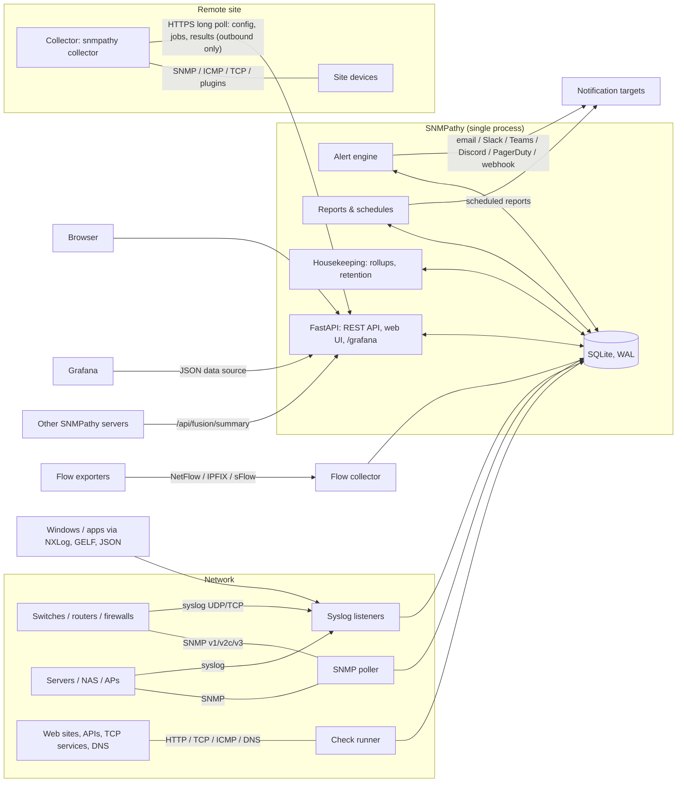
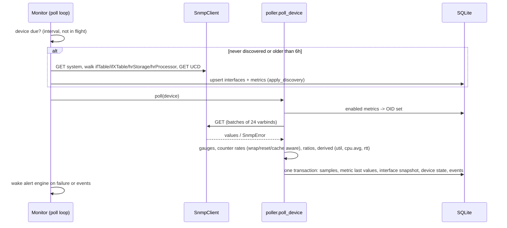
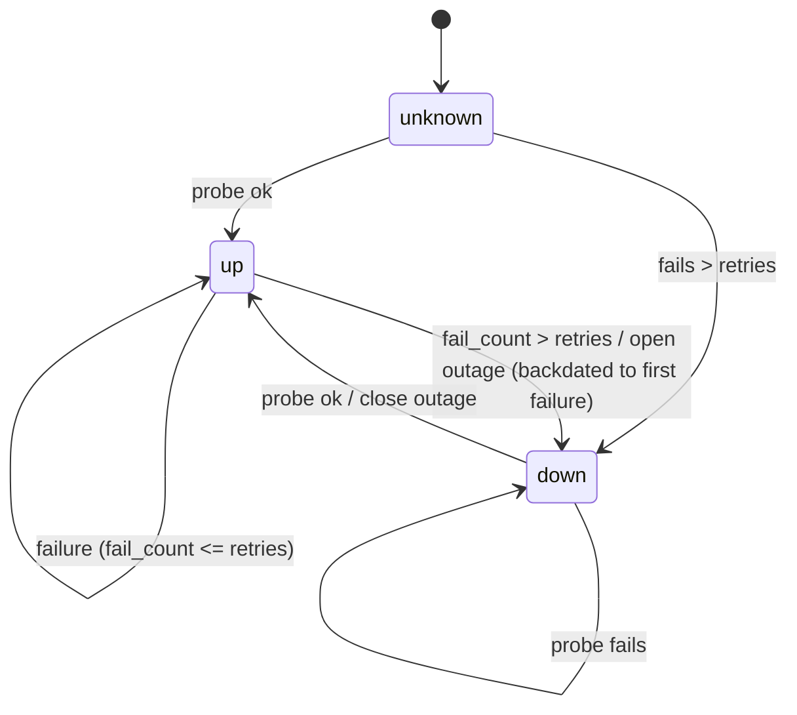
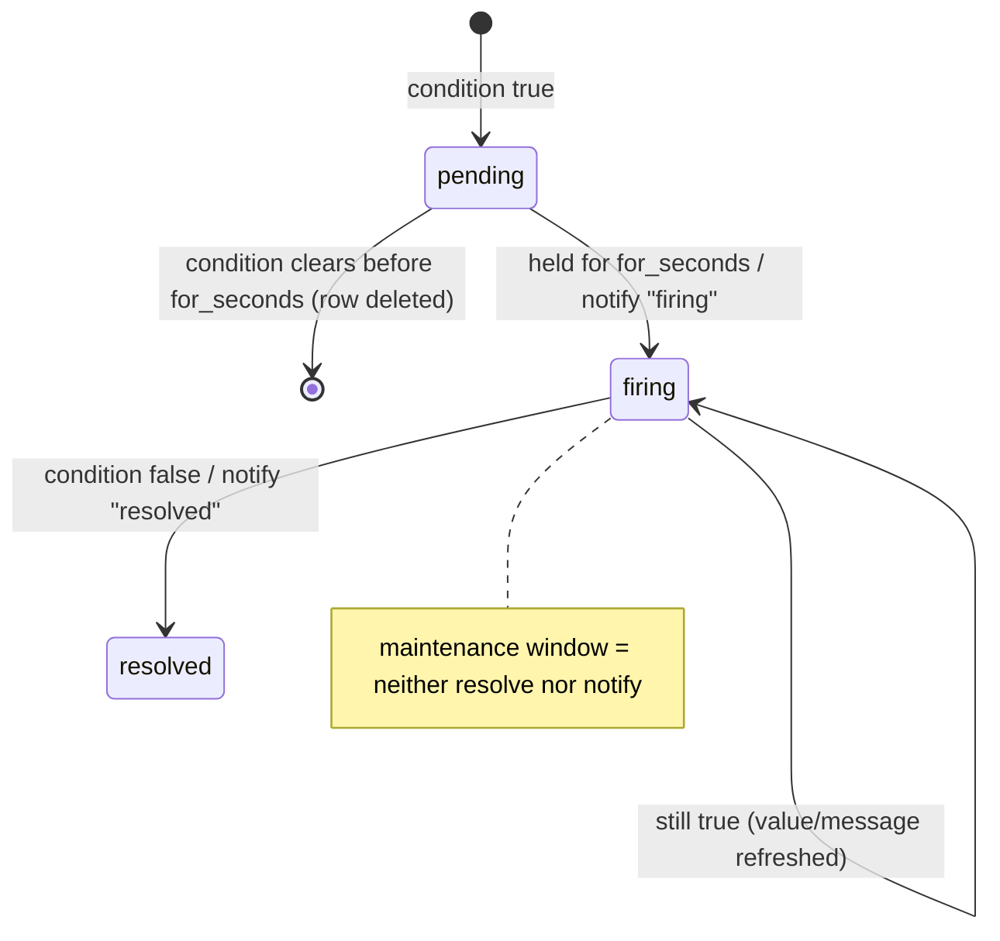
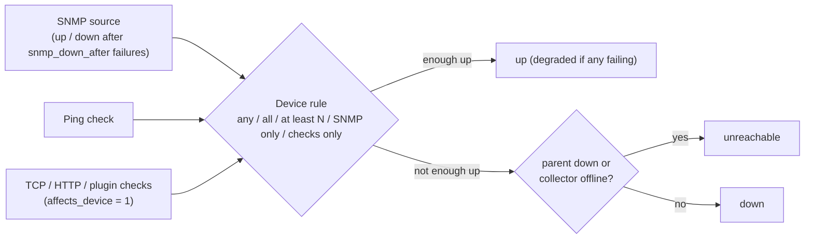
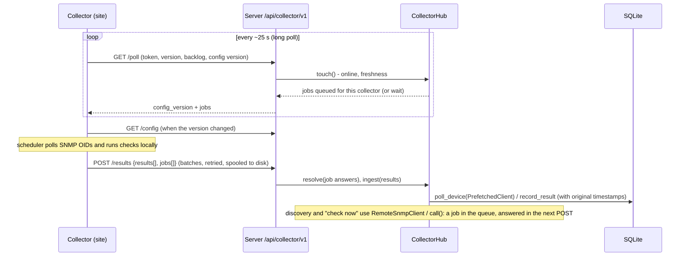
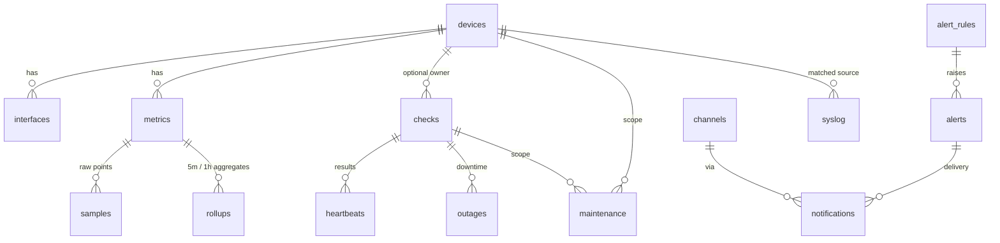
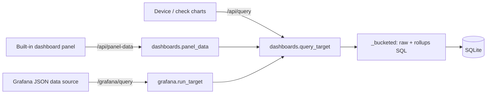
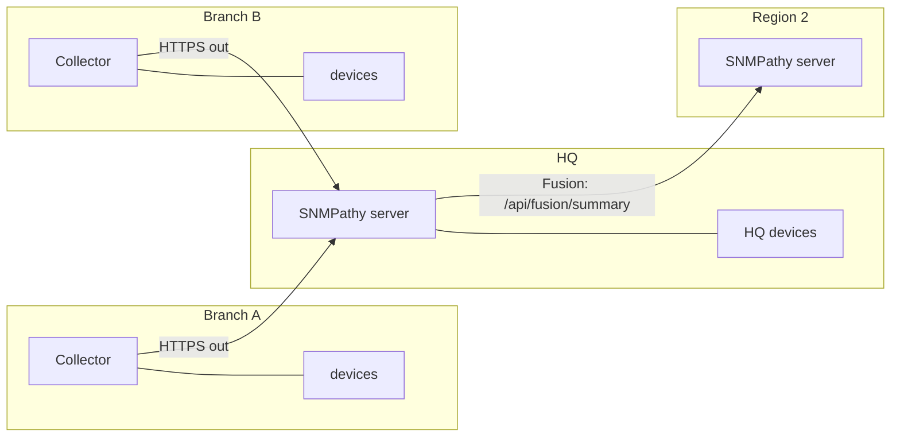

# SNMPathy: Architecture and Requirements

| | |
|---|---|
| **Product** | SNMPathy: self-hosted network monitoring (SNMP polling, network discovery, distributed collectors, topology maps, syslog / log analysis, flow analysis, uptime checks, alerting, dashboards, multi-server Fusion view, reporting) |
| **Version** | 0.1.0 |
| **Status** | Implemented. This document describes the system as built. |
| **Audience** | Engineers operating, extending or reviewing SNMPathy |

---

## 1. Purpose and scope

SNMPathy gives small and mid-sized network teams one lightweight service that covers the
common jobs of several separate tools:

| Tool it replaces | Capability in SNMPathy |
|---|---|
| Observium / LibreNMS / PRTG | SNMP auto-discovery and polling of interfaces, CPU, memory and storage, with graphs |
| Zabbix | Threshold, availability and log-pattern alerting with notifications |
| Uptime Robot | ICMP / TCP / HTTP / DNS / SNMP availability checks, SLA figures, a public status page |
| ELK (for network logs) | Syslog collection, full-text search, facets and volume histograms |
| Grafana | Built-in editable dashboards, plus a native Grafana data source |
| Auvik | Network scanning with auto-add, LLDP/CDP topology map grouped by site, remote collectors |
| Nagios Core / XI (distributed) | Remote collectors with passive result submission, Nagios plugins, passive checks with freshness, parent/child *unreachable* logic, multi-method host status |
| Nagios Fusion | Combined tactical dashboard across several independent SNMPathy servers |
| Nagios Log Server | Field-aware log search, filters, multi-query histograms, saved searches, Windows Event Log (NXLog) / GELF / JSON inputs |
| Nagios Network Analyzer | NetFlow v5/v9, IPFIX and sFlow collection with top talkers, applications, conversations and bandwidth graphs |

**Design goals:**

1. Installs in minutes on Windows, macOS, Linux or Docker, with no external database,
   message queue or agent.
2. Useful immediately: discovery, default alert rules and ready-made dashboards need no
   configuration.
3. Everything is available over a documented REST API.
4. Small, readable codebase that is easy to extend (about 11.5k lines of Python, JS, CSS and HTML, plus about 1k lines of tests).

**Non-goals** for this version: SNMP traps, configuration management (backing up device
configs), multi-tenant RBAC, and horizontal scale-out of one server's database beyond a
single node (sites scale out with collectors and servers combine with Fusion; see §3.14).

---

## 2. Requirements

Priorities: **M** = must, **S** = should, **C** = could. Every **M** and **S** requirement
listed here is implemented; the *Where* column points to the implementing module and the
covering test.

### 2.1 Functional requirements

#### SNMP monitoring

| ID | Pri | Requirement | Where |
|---|---|---|---|
| FR-SNMP-1 | M | Poll devices over SNMP v1, v2c and v3 (noAuthNoPriv / authNoPriv / authPriv; MD5, SHA-1, SHA-2 auth; DES, 3DES, AES-128/192/256 privacy). | `snmp/client.py`, `tests/test_live_snmp.py` |
| FR-SNMP-2 | M | Auto-discover the system group, vendor (from sysObjectID), interfaces (ifTable + ifXTable), CPU and storage (HOST-RESOURCES-MIB), and load and memory (UCD-SNMP-MIB). | `snmp/discovery.py`, `tests/test_snmp.py` |
| FR-SNMP-3 | M | Prefer 64-bit HC counters, convert counters to rates, and handle 32/64-bit wraparound and counter resets. | `snmp/poller.py::counter_delta` |
| FR-SNMP-4 | M | Derive interface utilisation %, average CPU and SNMP response time. | `snmp/poller.py` |
| FR-SNMP-5 | M | Detect device reboots (sysUpTime going backwards) and interface oper-status changes, recording them as events. | `snmp/poller.py`, `tests/test_snmp.py::test_reboot_and_interface_events` |
| FR-SNMP-6 | M | Track SNMP reachability as one availability source (down after `snmp_down_after` consecutive failed polls, backdated) and record the transition. | `snmp/poller.py::_mark_failure`, `tests/test_availability.py` |
| FR-SNMP-7 | S | Re-discover periodically (6 h) and when credentials change; stop polling vanished series but keep their history. | `monitor.py`, `snmp/discovery.py::apply_discovery` |
| FR-SNMP-8 | S | User-defined custom OIDs per device (gauge, counter, ratio, inverse ratio). | `services.py::add_custom_metric` |
| FR-SNMP-9 | S | Test credentials without saving; CLI `get` / `walk` / `discover` tools that need no net-snmp. | `api.py::test_snmp`, `cli.py` |
| FR-SNMP-10 | S | Reject impossible counter spikes (> 2× line rate) and the zero rates caused by agent counter caching. | `snmp/poller.py` |

#### Syslog

| ID | Pri | Requirement | Where |
|---|---|---|---|
| FR-LOG-1 | M | Receive syslog over UDP and TCP (newline, NUL and RFC 6587 octet-counted framing). | `syslog/server.py`, `tests/test_syslog_server.py` |
| FR-LOG-2 | M | Parse RFC 5424 (including structured data) and RFC 3164, plus real-world variants: Cisco sequence numbers and `%FAC-SEV-MNEMONIC`, ISO timestamps in BSD messages, a missing hostname, a missing PRI. | `syslog/parser.py`, `tests/test_syslog_parser.py` |
| FR-LOG-3 | M | Fall back to receipt time when the device clock is unsynchronised or more than 24 h off. | `syslog/parser.py::_trust` |
| FR-LOG-4 | M | Full-text search (phrases, exclusions, prefixes, boolean operators) with filters on host (wildcards), app, minimum severity, facility, device and time. | `syslog/search.py`, `tests/test_api.py::test_syslog_search_endpoints` |
| FR-LOG-5 | M | Volume histogram by severity band, and top-N facets by host / app / severity. | `syslog/search.py` |
| FR-LOG-6 | S | Associate messages with known devices by source IP or hostname. | `syslog/server.py::_devices` |
| FR-LOG-7 | S | Live tail in the UI. | `web/static/app.js::syslogExplorer` |
| FR-LOG-8 | S | Degrade gracefully to LIKE search when SQLite lacks FTS5. | `db.py::FTS_SCHEMA`, `syslog/search.py::_run` |
| FR-LOG-9 | M | Structured inputs: GELF over UDP (zlib / gzip, chunked), JSON lines over TCP (NXLog Windows Event Log, Fluent Bit, Vector, Filebeat) and JSON over UDP; extra fields stored and searchable. | `syslog/structured.py`, `tests/test_structured_logs.py` |
| FR-LOG-10 | M | Field-qualified query language (host / app / severity / facility / source_ip with CIDR / msgid / any structured field, comparisons, wildcards, NOT / OR / AND, grouping) plus include / exclude filter pills. | `syslog/search.py`, `tests/test_log_explorer.py` |
| FR-LOG-11 | M | Explorer: field sidebar with counts and top values, multi-query histogram, expandable events, saved searches, CSV export, live tail, create alert from query. | `syslog/web.py`, `web/templates/syslog.html` |
| FR-LOG-12 | S | A log sources page with listener status, senders and setup instructions for common platforms. | `/logs/sources` |

#### Availability and uptime

| ID | Pri | Requirement | Where |
|---|---|---|---|
| FR-UP-1 | M | Check types: ICMP ping, TCP connect, HTTP(S) (method, expected status, keyword present / absent, TLS verification, certificate-expiry threshold), DNS resolution (optional expected address) and SNMP agent. | `checks/probes.py`, `tests/test_checks.py` |
| FR-UP-2 | M | Per-check interval, timeout, and *retries before down*; faster re-probing while a check is failing. | `checks/runner.py`, `monitor.py::_check_loop` |
| FR-UP-3 | M | Outage history, backdated to the first failed probe. | `checks/runner.py::record_result` |
| FR-UP-4 | M | Availability %, downtime, outage count, longest outage, MTTR, MTBF and response-time statistics for any window. | `reports.py::availability` |
| FR-UP-5 | M | Exclude maintenance windows from SLA figures, and exclude time before a check existed. | `reports.py`, `tests/test_reports.py` |
| FR-UP-6 | S | 90-day per-day uptime bars and a public, unauthenticated status page of selected checks. | `reports.py::daily_bars`, `/status` |
| FR-UP-7 | M | Automatically create a ping check for each new device (optional). | `services.py::create_device` |
| FR-UP-8 | M | Nagios plugin checks: run a plugin by name from allowed plugin directories (never a path), map exit codes 0/1/2/3 to OK/WARNING/CRITICAL/UNKNOWN, substitute `$HOSTADDRESS$` / `$HOSTNAME$` / `$PORT$`, enforce a timeout, and store performance data as metrics on the linked device. | `checks/probes.py::nagios_plugin`, `checks/runner.py::store_perfdata` |
| FR-UP-9 | M | Passive checks: accept results (NRDP-style: host + service or check id, state 0-3, output with perfdata, optional timestamp) and fail a check that receives nothing for an interval (freshness). | `api.py::submit_passive`, `monitor.py::_check_loop` |
| FR-UP-10 | S | A WARNING state for checks that pass but need attention. | `checks/runner.py` |

#### Device availability (online / offline rules)

| ID | Pri | Requirement | Where |
|---|---|---|---|
| FR-AV-1 | M | Derive each device's status from all of its availability sources: SNMP polling and every enabled check linked to it that counts toward the device. | `availability.py::device_sources`, `tests/test_availability.py` |
| FR-AV-2 | M | Per-device rule: online if **any** source responds (default), only if **all** respond, if at least **N** respond, SNMP only, or checks only. One failing method on an online device marks it *degraded*, not down. | `availability.py::combine` |
| FR-AV-3 | M | Backdate a device outage to the failure that made the rule fail; keep device outages and report device-level availability. | `availability.py::evaluate_device`, `reports.py::device_availability`, `reporting.py` |
| FR-AV-4 | M | Nagios-style *unreachable*: a failing device whose parent is down or unreachable, or whose collector is offline, is unreachable rather than down and does not raise the device-offline alert; children are re-evaluated when a parent changes. Parent loops are rejected. | `availability.py`, `services.py::_check_parent` |
| FR-AV-5 | M | The device-offline alert follows the combined status; the check-down alert can skip checks on devices that are still online. | `alerting/engine.py` |
| FR-AV-6 | S | Change SNMP credentials and other settings for many devices at once. | `api.py::bulk_devices`, `devices.html` |

#### Network discovery (scanning)

| ID | Pri | Requirement | Where |
|---|---|---|---|
| FR-SC-1 | M | Targets as CIDR blocks (IPv4/IPv6), short and full ranges, single addresses and host names, with exclusions and a 65,536-address cap per scan. | `scanner.py::expand_targets`, `tests/test_scanner.py` |
| FR-SC-2 | M | Probe each host with ICMP, optional TCP ports and SNMP, trying several v2c communities and SNMPv3 users in order; record ping time, open ports, the credentials that worked, sysName, sysDescr, sysObjectID, vendor and reverse DNS. | `scanner.py::scan_host` |
| FR-SC-3 | M | Mark hosts that are already monitored (by address, resolved host name or DNS name). | `scanner.py::ScanManager._match_existing` |
| FR-SC-4 | M | Add results as devices automatically (hosts answering SNMP, or any responding host) or by selection, with the working credentials, tags, location, poll interval and online rule, a ping check for pingable hosts and a TCP check for port-only hosts; resolve name clashes. | `scanner.py::add_result`, `ScanManager.add` |
| FR-SC-5 | M | Run scans in the background with live progress; cancel; repeat on a schedule; run from a remote collector. | `scanner.py::ScanManager`, `monitor.py::_collector_loop` |
| FR-SC-6 | S | CLI `snmpathy scan` with optional adding to the database. | `cli.py::cmd_scan` |

#### Remote collectors (distributed monitoring)

| ID | Pri | Requirement | Where |
|---|---|---|---|
| FR-CO-1 | M | Register collectors with per-collector tokens (stored hashed, shown once, rotatable, revocable by disabling or deleting). | `collectors.py`, `collector_api.py`, `tests/test_collectors.py` |
| FR-CO-2 | M | Collectors connect outbound only (HTTP(S) long polling); no inbound connection to the site is needed. | `collector_agent.py`, `collector_api.py::collector_poll` |
| FR-CO-3 | M | Collectors pull their configuration (assigned devices with credentials and OIDs, assigned checks) and schedule polls and checks themselves; the server ingests the pushed results through the same poller and check state machine. | `collectors.py::CollectorHub.config / ingest` |
| FR-CO-4 | M | Results are buffered on the collector (and spooled to disk) while the server is unreachable and replayed in order with original timestamps; stale or replayed results are ignored. | `collector_agent.py`, `collectors.py::ingest` |
| FR-CO-5 | M | On-demand jobs relayed to a collector: SNMP get/walk (discovery, LLDP), check now, network-scan host probes, ping. | `collectors.py::CollectorHub.call`, `RemoteSnmpClient` |
| FR-CO-6 | M | Freshness: a collector silent for `collector_offline_after` seconds is offline (event logged) and its devices become unreachable; they are re-evaluated when it returns. | `collectors.py::sweep / touch` |
| FR-CO-7 | M | Download the collector from the main host: platform executables (from a downloads folder, or the running executable itself), a pip-installable package, and one-line install scripts that install a service on Windows (scheduled task), Linux (systemd) and macOS (launchd); Docker profile. | `collector_api.py`, `docker-compose.yml`, `deploy/systemd/snmpathy-collector.service` |

#### Network map (topology)

| ID | Pri | Requirement | Where |
|---|---|---|---|
| FR-MAP-1 | M | Discover layer-2 neighbours from LLDP-MIB and CISCO-CDP-MIB during discovery (also through collectors) and match them to known devices and interfaces. | `snmp/neighbors.py`, `tests/test_neighbors.py` |
| FR-MAP-2 | M | Draw devices and links grouped by site (collector site or location prefix), with status, degraded/unreachable markers, link utilisation colour, link speed width, port labels and unmanaged neighbours. | `topology.py::build_graph`, `web/templates/map.html`, `tests/test_topology.py` |
| FR-MAP-3 | M | Drag and save layouts per view; site and tag views; search; details panels. | `topology.py`, `map.html` |
| FR-MAP-4 | S | Manual links; derive parent devices from the topology starting at a core device. | `topology.py::add_link / suggest_parents` |

#### Network Analyzer (flows)

| ID | Pri | Requirement | Where |
|---|---|---|---|
| FR-NA-1 | M | Collect NetFlow v5 and v9 (templates, options templates, sampling), IPFIX (variable-length and enterprise fields, withdrawals) and sFlow v5 (flow samples with Ethernet / VLAN / IPv4 / IPv6 headers) on UDP 2055 / 4739 / 6343, any format on any port; malformed packets are counted, never crash the listener. | `flows/parser.py`, `flows/collector.py`, `tests/test_flows.py` |
| FR-NA-2 | M | Aggregate per minute and exporter on the 5-tuple and interfaces, apply sampling rates (reported or overridden), cap memory, and register exporters automatically (linked to a device by address). | `flows/collector.py` |
| FR-NA-3 | M | Totals, bandwidth time series grouped by talker / destination / application / protocol / exporter with an "Other" series, top-N by source, destination, conversation, application, port, protocol, exporter and interface, with filters by exporter, IP, CIDR, port or service and protocol. | `flows/query.py`, `flows/web.py`, `tests/test_flow_web.py` |
| FR-NA-4 | M | Analyzer pages: overview with KPIs and drill-down, per-host view, exporter management, SNMP interface bandwidth alongside, and exporter setup guides. | `web/templates/traffic*.html` |
| FR-NA-5 | S | Flow bandwidth alert rules and a traffic report. | `flows/alerts.py`, `alerting/engine.py`, `reporting.py` |

#### Fusion (multi-server view)

| ID | Pri | Requirement | Where |
|---|---|---|---|
| FR-FU-1 | M | Each server exposes a compact summary (status counts, problems, firing alerts, top metrics) at `/api/fusion/summary`. | `fusion.py::summary`, `tests/test_fusion.py` |
| FR-FU-2 | M | A Fusion server polls registered remote servers (URL + API token, TLS verification option) every minute and keeps the last good data, marking stale and failed servers. | `fusion.py::fetch_server / FusionPoller` |
| FR-FU-3 | M | One tactical overview: aggregate tiles, per-server tiles, merged problems sorted by severity and age with links into each server, merged firing alerts, cross-server top CPU / memory / interfaces / worst availability. | `fusion.py::combined`, `web/templates/fusion.html` |

#### Alerting and notification

| ID | Pri | Requirement | Where |
|---|---|---|---|
| FR-AL-1 | M | Rule kinds: metric threshold (`> >= < <= == !=`), check down, device unreachable, and syslog pattern count per host within a window. | `alerting/engine.py`, `tests/test_alerts.py` |
| FR-AL-2 | M | Wildcard metric keys (`if.*_util`) and instance / label globs; scope a rule to a device or a device tag. | `alerting/engine.py` |
| FR-AL-3 | M | Lifecycle pending → firing → resolved, with a "for" duration; a pending alert that clears leaves no trace. | `alerting/engine.py::AlertEngine.evaluate` |
| FR-AL-4 | M | Ignore stale metric data so a silent device does not hold a threshold alert open. | `alerting/engine.py` |
| FR-AL-5 | M | Channels: email (SMTP / SMTPS / STARTTLS), Slack-compatible webhooks, Microsoft Teams, Discord, PagerDuty Events v2 (with dedup key and resolve), a generic JSON webhook, and log. | `alerting/notify.py` |
| FR-AL-6 | M | Maintenance windows (global / device / check) suppress notifications and hold existing alert state. | `alerting/engine.py`, `tests/test_alerts.py` |
| FR-AL-7 | S | Acknowledge alerts, keep a notification delivery log, and send a test message from any channel. | `api.py` |
| FR-AL-8 | S | Evaluate immediately on state changes rather than waiting for the next interval. | `monitor.py::_alert_wakeup` |
| FR-AL-9 | S | Sensible default rules and a log channel on first start. | `services.py::seed_defaults` |

#### Dashboards and visualisation

| ID | Pri | Requirement | Where |
|---|---|---|---|
| FR-DB-1 | M | Built-in, persistent, editable dashboards laid out on a 12-column grid. | `dashboards.py`, `web/static/app.js::SP.dashboard` |
| FR-DB-2 | M | Panel types: time series (lines / area / stacked bars / bars), stat, gauge, top-N table, status grid, uptime bars, syslog volume / stream / top, firing alerts, events, overview counters, text. | `dashboards.py::panel_data` |
| FR-DB-3 | M | Queries select metrics by key, device, tag and instance, with aggregation (each / sum / avg / max / min), a series limit and alias templates; plus check response-time / availability series and syslog count series. | `dashboards.py::query_target` |
| FR-DB-4 | M | View options: time range presets from 15 min to 1 year plus a custom range, auto-refresh, light / dark / system theme, kiosk (TV) mode, panel enlarge, legend isolate / toggle, crosshair tooltips. | `app.js` |
| FR-DB-5 | M | Panel editor with live preview; reorder, resize and duplicate panels; JSON model import / export; duplicate dashboards. | `app.js::panelEditor`, `api.py` |
| FR-DB-6 | M | Five ready-made dashboards: Network Overview, Traffic & Interfaces, Server & Device Health, Availability, Syslog. | `dashboards.py::DEFAULT_DASHBOARDS` |
| FR-DB-7 | S | Automatic resolution: raw samples for ranges up to 2 days, 5-minute rollups up to 21 days, hourly beyond that. | `storage.py::series`, `dashboards.py::_bucketed` |
| FR-DB-8 | S | A colour-vision-deficiency-safe categorical palette (validated for light and dark), and status shown by shape plus label, never by colour alone. | `web/static/app.css` |

#### Grafana integration

| ID | Pri | Requirement | Where |
|---|---|---|---|
| FR-GF-1 | M | Implement the Grafana JSON data source protocol (`simpod-json-datasource`): `/`, `/metrics`, `/metric-payload-options`, `/query`, `/variable`, `/tag-keys`, `/tag-values`. | `grafana.py`, `tests/test_api.py::test_grafana_datasource_protocol` |
| FR-GF-2 | M | Time-series targets (metric, check, syslog), a single-value target (count) and table targets (devices, checks, interfaces, alerts, syslog events, events, top-N). | `grafana.py::run_target` |
| FR-GF-3 | M | Template variables (devices, tags, checks, keys, interfaces, hosts), including Grafana's regex-formatted multi-value interpolation. | `grafana.py::variable`, `grafana_value` |
| FR-GF-4 | M | Five pre-built Grafana dashboards, downloadable from the UI and provisioned automatically in Docker Compose. | `grafana.py::grafana_dashboards`, `deploy/grafana/` |
| FR-GF-5 | S | `snmpathy grafana-export` writes provisioning files for existing Grafana installs. | `cli.py` |

#### Reporting

| ID | Pri | Requirement | Where |
|---|---|---|---|
| FR-RP-1 | M | Availability / SLA report per check against a configurable SLA target, with an outage list. | `reporting.py::uptime_report` |
| FR-RP-2 | M | Device health report: CPU and memory average / peak, fullest disk, ping availability, SNMP latency, reboots, ports down, log errors, and flagged issues. | `reporting.py::health_report` |
| FR-RP-3 | M | Bandwidth report: per-interface average, peak, 95th percentile (from 5-minute averages), utilisation and bytes transferred. | `reporting.py::bandwidth_report`, `tests/test_reports.py` |
| FR-RP-4 | M | Syslog summary: counts by severity, top hosts / apps, most frequent warning and error *patterns* (variable parts collapsed), per-day volume. | `reporting.py::syslog_report` |
| FR-RP-5 | M | Alert history: counts by rule and severity, noisiest subjects, MTTA and MTTR. | `reporting.py::alerts_report` |
| FR-RP-6 | M | Periods: sliding windows (`24h`, `7d`, …) and calendar periods (today, yesterday, this / last week, this / last month); filter by device or tag. | `reporting.py::resolve_range` |
| FR-RP-7 | M | Output: web view, CSV (whole report or one section), JSON, and a print-optimised layout for PDF. | `reporting.py::to_csv`, `report.html` |
| FR-RP-8 | M | Scheduled delivery (daily / weekly / monthly at a chosen hour): email as HTML plus a CSV attachment, chat summaries, webhook JSON, with a "send now" action and delivery status. | `scheduled.py`, `tests/test_dashboards_and_schedules.py` |

#### Platform, API and administration

| ID | Pri | Requirement | Where |
|---|---|---|---|
| FR-AD-1 | M | REST API for every object and action, with OpenAPI docs at `/docs`. | `api.py` |
| FR-AD-2 | M | Optional token authentication for UI and API (Bearer, `X-API-Key` or a login cookie); status page and health check stay public. | `app.py` |
| FR-AD-3 | M | Configuration via YAML, `SNMPATHY_*` environment variables and CLI flags. | `config.py` |
| FR-AD-4 | M | Export and import configuration (devices, custom metrics, checks, rules, channels) as JSON, idempotently. | `services.py::export_config / import_config` |
| FR-AD-5 | M | Automatic rollups and retention per data class. | `storage.py` |
| FR-AD-6 | S | Demo mode with simulated devices, history and live syslog traffic. | `demo.py` |
| FR-AD-7 | S | System page showing version, ICMP mode, FTS availability, engine counters, table sizes and effective settings. | `/settings`, `/api/system` |

### 2.2 Non-functional requirements

| ID | Category | Requirement | How it is met |
|---|---|---|---|
| NFR-1 | Portability | Run natively on Windows 10/11 and Server 2019+, macOS 12+ and mainstream Linux, with Python 3.10 to 3.13, and in Docker. | Pure-Python dependencies with wheels on all three OSes; no Unix-only APIs; `asyncio.run` (Proactor loop on Windows); CI matrix on ubuntu / windows / macos (`.github/workflows/ci.yml`). |
| NFR-2 | Portability | ICMP checks work without elevated privileges on every platform. | Runtime detection: raw socket → unprivileged ICMP socket → system `ping` (always on Windows) → TCP probe, with automatic fallback when a mode fails (§3.10). |
| NFR-3 | Installability | One command to install and one to run; no external services. | `pip install .` then `snmpathy serve`; SQLite; Docker image and Compose file. |
| NFR-3a | Installability | A single-file executable per OS needs no Python on the target machine, and is stored in `<Claude folder>/SNMPathy/` next to the KASTR, DiskWorks and LinkTest projects. | PyInstaller spec (`packaging/snmpathy.spec`) and `scripts/build_executable.py`; when frozen, the data and config live next to the executable; CI publishes the executables as artifacts. |
| NFR-4 | Operability | Runs as a system service on each OS. | systemd unit, launchd plist, Windows service via NSSM or a scheduled task (`deploy/`). |
| NFR-5 | Performance | Poll a few hundred devices at 5-minute intervals and ingest sustained syslog on one modest host. | Async I/O with bounded concurrency (64); batched writes. Measured on a single core: ~16,000 syslog messages/s parsed, FTS-indexed and stored; ~950,000 metric samples/s written. |
| NFR-6 | Responsiveness | Dashboards render in well under a second for typical ranges. | Rollups, bucketed SQL aggregation, at most ~300 points per series, at most 50 series per panel (8 coloured, the rest grey). The demo's five dashboards compute in 10 to 50 ms server-side. |
| NFR-7 | Reliability | A failure in one device, check, rule or channel never stops the engine. | Every job and loop is isolated with exception logging; notification failures are recorded, not raised. |
| NFR-8 | Data integrity | Concurrent writers are safe; a crash does not corrupt data. | SQLite WAL mode, one serialised connection, explicit transactions. |
| NFR-9 | Accuracy | Rates and SLA figures are correct across counter wraps, reboots, agent caching and maintenance. | Unit tests with exact expectations (`tests/test_snmp.py`, `tests/test_reports.py`). |
| NFR-10 | Security | Secrets are not exposed back to clients; the auth token is compared in constant time; there are no shell injection paths. | SNMPv3 keys are write-only; channel secrets are masked; `hmac.compare_digest`; `ping` runs via `exec` with an argument list. |
| NFR-11 | Accessibility | Status is conveyed by shape and label as well as colour; the UI is keyboard reachable, responsive to phone width, and has light and dark themes. | `app.css` status classes; responsive grid; theme tokens. |
| NFR-12 | Maintainability | No front-end build step; clear module boundaries; automated tests. | Vanilla JS/CSS; 70+ pytest tests, including live-agent and HTTP-level tests. |
| NFR-13 | Retention | Configurable per data class, with defaults of 7 days raw, 35 days 5-minute, 400 days hourly, 30 days syslog and 90 days check results. | `storage.py::apply_retention`. |

### 2.3 Out of scope / roadmap candidates

* SNMP trap receiver (UDP 162) feeding the syslog / event pipeline
* Vendor-specific MIB packs (BGP peers, optics dBm, PoE, wireless clients)
* Users, roles and per-team permissions; SSO (OIDC / SAML)
* Layer-3 topology (routing tables, ARP/FDB-based placement of end hosts) on the map
* Pushing collector upgrades from the server
* PostgreSQL / TimescaleDB storage backend for large installations

---

## 3. Architecture

### 3.1 System context

### 3.2 Process model

SNMPathy is **one Python process** running one asyncio event loop:

* **Uvicorn / FastAPI** serves the UI, the REST API and the Grafana endpoint. Synchronous
  API handlers run in FastAPI's thread pool, so SQLite queries never block the event loop.
* The **Monitor** (`monitor.py`) starts long-lived tasks when the app starts up:

| Task | Cadence | Work |
|---|---|---|
| `snmp-poller` | 1 s scheduler tick | starts `_poll_job` for each device that is due (per-device interval, initial jitter, no overlap for the same device); discovers when needed |
| `check-runner` | 0.5 s tick | starts `_check_job` for each due check; uses a shorter interval while a check is failing but not yet down |
| `alert-engine` | `alert_eval_interval` (30 s), **or immediately** after a state change | evaluates all rules and sends notifications |
| `housekeeping` | 60 s | 5-minute and hourly rollups, due scheduled reports; hourly retention |
| syslog listeners + writer | continuous | UDP protocol and TCP server feed a bounded queue (100k); the writer batches up to 500 messages or 1 s per transaction |
| structured log inputs | continuous | GELF over UDP (12201), JSON lines over TCP (5544), optional JSON over UDP; same queue and writer as syslog |
| flow collector | continuous; flush every 10 s | NetFlow v5/v9, IPFIX and sFlow datagrams are decoded and aggregated per minute in memory, then written to `flows` |
| `collectors` | 10 s | marks silent collectors offline (their devices become unreachable); starts recurring network scans that are due |
| Fusion poller | 60 s | fetches `/api/fusion/summary` from each registered remote server |
| network scans | on demand / schedule | `ScanManager` tasks probe hosts with bounded concurrency, locally or through a collector |

A global semaphore (`poller_concurrency`, default 64) bounds simultaneous SNMP polls and
checks. Every job is wrapped so a failure is logged and counted, never propagated.

### 3.3 Components

| Module | Responsibility |
|---|---|
| `config.py` | `Settings` dataclass; merge of defaults, YAML and `SNMPATHY_*` environment variables |
| `db.py` | Schema, migrations, a thread-safe `Database` wrapper (RLock-serialised connection, nested transactions), optional FTS5 |
| `snmp/client.py` | `SnmpClient` protocol; `PySnmpClient` (pysnmp asyncio HLAPI, v1/v2c/v3, batched GET, GETBULK walk, v1 fallbacks); `FakeSnmpClient` for tests |
| `snmp/mibs.py` | Numeric OIDs, vendor enterprise map, metric metadata |
| `snmp/discovery.py` | Builds `MetricSpec`s from walks; `apply_discovery` upserts interfaces and metrics |
| `snmp/poller.py` | GETs all enabled OIDs, computes gauges, rates and ratios, derived metrics, reboot and port events, and device state |
| `checks/probes.py` | ICMP (multi-mode), TCP, HTTP(S) with cert expiry, DNS, SNMP probes; ping output parsing for Linux, macOS and Windows |
| `checks/runner.py` | Probe dispatch; state machine with retries; heartbeats and outages |
| `syslog/parser.py` | RFC 5424 / 3164 / vendor parsing; TCP stream framing |
| `syslog/server.py` | UDP / TCP listeners, a bounded queue, a batched writer, device mapping, stats |
| `syslog/search.py` | Filter model, safe FTS query construction with LIKE fallback, histogram, top-N |
| `alerting/engine.py` | Rule evaluation and the alert lifecycle; maintenance suppression |
| `alerting/notify.py` | Channel implementations and a delivery log |
| `reports.py` | Interval arithmetic, availability / SLA maths, daily bars |
| `reporting.py` | Five report builders with a common structure; CSV and text output |
| `scheduled.py` | Schedule maths (`previous_occurrence`), rendering (HTML email) and delivery |
| `dashboards.py` | Target resolution, bucketed multi-series queries, panel data, default dashboards |
| `grafana.py` | JSON data source protocol, Grafana dashboard generator, provisioning writer |
| `storage.py` | Series queries with automatic resolution, rollups, retention, DB stats |
| `services.py` | Validation and business logic shared by the API, UI and CLI; seeding; export / import |
| `api.py` | REST API (Pydantic models) |
| `web/` | Jinja templates, `app.js` (charts, dashboards, editor, syslog explorer), `app.css` |
| `availability.py` | Combines a device's sources (SNMP + checks) under its rule; degraded / unreachable; device outages |
| `scanner.py` | Target expansion, per-host probing (pure, runs on collectors too), `ScanManager` (background and recurring scans, matching, adding devices) |
| `collectors.py` | Collector tokens, the `CollectorHub` (job relay, config builder, result ingest, freshness), `RemoteSnmpClient` |
| `collector_api.py` | Collector-facing endpoints, collector management API, downloads (executables / package) and install scripts |
| `collector_agent.py` | The collector process: config sync, local scheduler, buffered uploader with disk spool, job executor |
| `snmp/neighbors.py` | LLDP / CDP neighbour discovery and link resolution |
| `topology.py` | Map graph (sites, nodes, links, utilisation), layouts, manual links, parents from topology |
| `fusion.py` | Server summary, remote fetching, combined multi-server view |
| `flows/` | NetFlow / IPFIX / sFlow decoders, collector and aggregator, flow queries, analyzer pages, flow alerts and traffic report |
| `syslog/structured.py` | GELF (incl. chunked / compressed), NXLog Windows Event Log and generic JSON inputs |
| `monitor.py` | Scheduling and orchestration |
| `app.py` | App factory, auth middleware, login, health check |
| `cli.py` | `serve`, `demo`, `init-config`, `get`, `walk`, `discover`, `ping`, `send-syslog`, `add-device`, `scan`, `collector`, `export`, `import`, `grafana-export`, `version` |
| `demo.py` | Simulated agents (monotonic counters from an analytic traffic model), synthetic outages, a syslog generator, history backfill through the real code paths |

### 3.4 Key flows

#### SNMP poll

#### Check state machine

Every probe writes a heartbeat (`ok`, latency, message). Outages are what SLA maths uses.
Heartbeats feed response-time charts and the "checks run / failed" statistics.

#### Syslog ingest

`datagram / TCP frame → queue (bounded, drop + count on overflow) → writer task → parse →
map to device → executemany INSERT (FTS triggers index message, host, app)`. Parsing runs in
a worker thread (`asyncio.to_thread`), so bursts don't stall the event loop.

#### Alert lifecycle

An alert's identity is its **fingerprint**: `r<rule>:m<metric>`, `r<rule>:c<check>`,
`r<rule>:d<device>` or `r<rule>:h<host>`. At most one open alert exists per fingerprint.

#### Device availability

`evaluate_device` runs whenever a poll finishes, a check changes state, the device or its
checks are edited, a collector connects or disconnects, or the parent changes (children
are re-evaluated recursively, loop-safe). A transition to down / unreachable opens a
`device_outages` row backdated to the failure that broke the rule (for *any*: the last
source to fail; for *all*: the first; for *N*: the failure that dropped the count below
N). Device availability in reports uses those intervals minus maintenance.

#### Remote collector

#### Network scan

`targets → expand_targets → per host (bounded concurrency): ICMP + TCP ports + SNMP GET
(sysDescr / sysObjectID / sysName) for each credential until one answers → reverse DNS →
scan_results row → match existing devices → optional auto-add (device + credentials + ping
or TCP check)`. A scan bound to a collector sends each host as a `scan_host` job.

### 3.5 Data model

| Table | Notes |
|---|---|
| `devices` | Identity, SNMP credentials (v3 keys write-only through the API), system info, poll timing, availability rule (`avail_mode`, `avail_min`, `snmp_down_after`), SNMP source state, combined status / reason / degraded, `parent_id`, `collector_id` |
| `interfaces` | Per-ifIndex details and a live snapshot (oper status, in / out bps) |
| `metrics` | One row per series: `(device, key, instance)` unique; kind (`gauge`, `counter`, `ratio`, `ratio_free`, `derived`); OIDs; unit / scale / counter width; last raw value and last computed value |
| `samples` | `(metric_id, ts)` primary key, `WITHOUT ROWID`, about 15 to 20 bytes per point |
| `rollups` | `(metric_id, period, bucket)` holding min / max / avg / count, for periods of 300 and 3600 seconds |
| `checks`, `heartbeats`, `outages` | Availability definitions (incl. `affects_device`, `collector_id`, `warning`), every probe result, and state intervals |
| `syslog` (+ `syslog_fts`) | Parsed messages; external-content FTS5 index kept in sync by triggers |
| `alert_rules`, `alerts`, `channels`, `notifications` | Alerting |
| `maintenance` | Windows scoped globally, to a device or to a check |
| `dashboards` | Name, slug and JSON config (`time`, `refresh`, `panels[]`) |
| `report_schedules` | Report, period, frequency / hour / weekday / monthday, channels, last run and status |
| `events` | Human-readable audit trail (state changes, reboots, discovery, alerts) |
| `device_outages` | Device-level downtime intervals derived from the availability rule |
| `scans`, `scan_results` | Scan definitions (targets, options incl. credentials to try, schedule, collector) and responsive hosts |
| `collectors` | Name, site, hashed token, last contact, host / platform / version, results and backlog counters, online state |
| `links`, `map_positions` | LLDP / CDP / manual adjacencies (resolved to devices and interfaces) and saved map layouts |
| `fusion_servers` | Remote SNMPathy servers (URL, API token, TLS verification) and their last summary |
| `flow_sources`, `flows` | Flow exporters and minute-aggregated flow records |
| `saved_searches` | Saved log queries and filters |
| `meta` | Schema version, seed markers, rollup watermarks |

### 3.6 Storage, rollups and retention

* **Raw** samples are written on every poll. The housekeeping task rolls completed buckets
  into **5-minute** and **1-hour** aggregates, tracking a watermark per period.
* **Query resolution** is chosen automatically. Recent, not-yet-rolled-up data is
  appended from raw samples, so charts are never stale.
* **95th percentile** uses 5-minute averages (the burstable-billing definition), then
  hourly averages for windows older than the 5-minute retention.
* **Retention** runs hourly. Syslog deletes happen in chunks of 5,000 so writers are not
  blocked.

Sizing rule of thumb: bytes/day ≈ `series × (86400 / interval) × 20 B` + `syslog msgs/day × ~200 B`.
For example, 200 devices × 60 series at 5-minute polling is 12,000 series, about 70 MB/day of raw
samples (about 0.5 GB at 7-day retention). Adding 1 M syslog messages/day is about 200 MB/day.

### 3.7 Dashboards and the Grafana integration

The same **target** abstraction (`dashboards.query_target`) powers the built-in panels, the
charts on device and check pages, `/api/query`, and the Grafana data source. That keeps
semantics (wildcards, aggregation, aliasing, limits) identical everywhere.

* Built-in dashboards are stored as JSON in `dashboards.config`. The front end
  (`SP.dashboard`) renders a 12-column grid, fetches each panel independently, and
  re-renders on time-range change or auto-refresh (paused while the tab is hidden or while
  editing).
* The charting library in `app.js` is an SVG renderer with no dependencies. It provides
  nice ticks, local-time axes, gap detection, stacked bars with a 2 px surface gap,
  crosshair tooltips, list or table legends with isolate / toggle, threshold lines and
  resize handling. Series colours come from an 8-slot palette validated for colour-vision
  deficiency (light and dark variants); series beyond 8 fold to grey.
* The Grafana dashboards are generated in code (`grafana.grafana_dashboards`), so they stay
  in sync with the data source's target names. They are served at
  `/grafana/dashboards/*.json` and written to `deploy/grafana/provisioning`.

### 3.8 Reporting pipeline

Every report builder returns
`{id, title, subtitle, start, end, summary[], sections[{title, columns[{key,label,fmt}], rows[]}]}`.
One structure drives four outputs: the HTML page (`report.html`), CSV (`to_csv`, whole report
or one section), email HTML (`report_email.html` with inline styles for mail clients) and
chat text (`to_text`). Scheduled reports are checked every minute. A schedule is due when
its last run is older than the most recent scheduled occurrence and that occurrence falls
after the schedule was created, so nothing is back-filled on first start.

### 3.9 Security model

* **Authentication:** optional single shared token (`api_token`). It is accepted as
  `Authorization: Bearer`, `X-API-Key`, `?token=`, or an HttpOnly SameSite=Lax cookie set
  by `/login`. It is compared with `hmac.compare_digest`. Public paths are `/status`,
  `/api/status-page`, `/healthz`, `/login`, `/static/`, the collector endpoints (own
  tokens) and `/collector/` downloads.
* **Secrets:** SNMPv3 auth / priv keys are never returned by the API (only
  `has_v3_*_key` flags), and an empty value on update keeps the stored secret. Channel
  secrets (SMTP password, PagerDuty key) are masked and merged back on update.
* **Input handling:** all SQL is parameterised. Syslog search text is re-tokenised into
  quoted FTS5 phrases, so users cannot inject FTS syntax errors. Templates auto-escape, and
  the JS escapes every interpolated value. `ping` runs through `exec` with an argument
  list, never a shell.
* **Collectors:** each has its own random token (`col_…`), stored only as a SHA-256 hash,
  shown once, rotatable; a disabled or deleted collector is refused. Collector endpoints
  (`/api/collector/v1/*`) accept only collector tokens and only touch that collector's
  devices and checks. Collectors receive the SNMP credentials of their devices, so the
  server must be reached over HTTPS (reverse proxy) when collectors cross untrusted
  networks; the agent verifies TLS by default (`--ca-file` for private CAs).
* **Public download paths:** `/collector/*` (install scripts, executables, the Python
  package) needs no login so a site machine can fetch it; it contains no secrets (tokens
  are passed on the command line, never embedded).
* **Nagios plugins** run only by bare name from configured plugin directories, through
  `exec` with an argument list (no shell) and a timeout.
* **Fusion** stores remote API tokens in the database to call remote servers; they are
  never returned by the API. Data from remote servers is treated as untrusted (links must
  be site-relative, values are validated and escaped).
* **Least privilege:** the Docker image runs as UID 10001 with `NET_RAW` only. The systemd
  unit grants only `CAP_NET_RAW` and `CAP_NET_BIND_SERVICE` and enables `ProtectSystem=strict`.
* **Recommendations:** put SNMPathy behind TLS (a reverse proxy) when you expose it
  beyond a trusted network; use SNMPv3 authPriv; restrict syslog sources at the firewall.

### 3.10 Cross-platform strategy

| Concern | Linux | macOS | Windows | Docker |
|---|---|---|---|---|
| Event loop | default selector loop | default | Proactor via `asyncio.run` (supports UDP and subprocesses) | Linux |
| ICMP | raw socket (root / `CAP_NET_RAW`), else unprivileged ICMP socket, else `ping` | unprivileged ICMP datagram socket | `ping.exe` (no admin needed) | raw socket (`NET_RAW`), or ICMP socket via `ping_group_range` |
| Fallbacks | a socket mode that fails at runtime switches to `ping`, then to a TCP probe (ports 80, 443, 22, 3389; "connection refused" counts as up) | same | same | same |
| `ping` output | iputils | BSD (`-W` in ms, `-t` in s) | `time=` / `time<`, localised variants; `TTL=` required, because Windows returns 0 for "unreachable" | iputils |
| Syslog port | 5514 by default (514 needs root or `CAP_NET_BIND_SERVICE`) | 5514 | 5514 (plus a firewall rule, created by the installer) | host 514 → container 5514 |
| Service | systemd unit | launchd plist | NSSM service or a startup scheduled task (`install-service.ps1`) | `restart: unless-stopped` |
| SNMP tooling | built-in `snmpathy get / walk / discover` (no net-snmp dependency) | same | same | same |
| SQLite FTS5 | bundled with CPython builds; LIKE fallback otherwise | same | same | same |

The CI matrix runs the full test suite on all three operating systems with Python 3.10 and 3.13,
and additionally builds the Docker image and probes `/healthz`.

### 3.11 Deployment topologies

1. **Single host (most users):** `snmpathy serve` or the Windows / macOS / Linux
   service; the browser connects to port 8080.
2. **Docker:** `docker compose up -d`, with the data volume `snmpathy-data`.
3. **Docker with Grafana:** `docker compose --profile grafana up -d`. Grafana
   automatically gets the JSON plugin, the data source (UID `snmpathy`) and the five
   dashboards (folder "SNMPathy").
4. **Standalone executable:** `scripts/build_executable.(cmd|sh)` produces
   `SNMPathy.exe` / `SNMPathy` in `<Claude folder>/SNMPathy/`. Double-clicking it runs
   `serve` and opens the browser. `snmpathy.yaml` and `snmpathy.db` sit next to the
   executable.
5. **Behind a reverse proxy:** terminate TLS at nginx / Caddy / IIS and set
   `public_url` so links in notifications and reports are correct (also used in the
   collector install commands).
6. **Central server + collectors:** one server (usually behind HTTPS) and a collector per
   site, installed with the one-line command from the Collectors page (Windows scheduled
   task, systemd, launchd or `docker compose --profile collector`).
7. **Fusion:** several independent servers (per region, customer or security zone), plus
   one server whose Fusion page combines them; it needs only HTTPS access to each
   server's API with a token.

### 3.12 Extension points

| To add | Where |
|---|---|
| A vendor metric (e.g. optics power) | New `MetricSpec`s in `snmp/discovery.py` (walk the vendor table) and metadata in `mibs.METRIC_INFO`, or define it per device as a custom OID |
| A check type | `checks/probes.py` (probe) and `checks/runner.py::run_probe` + `CHECK_TYPES` |
| A notification channel | `alerting/notify.py::send` + `CHANNEL_TYPES`, and the form fields in `alerts.html` |
| A rule kind | `alerting/engine.py::evaluate_rule` + `RULE_KINDS` |
| A report | A builder in `reporting.py` returning the common structure, registered in `BUILDERS` / `REPORT_TYPES` |
| A panel type | `dashboards.panel_data` + `PANEL_TYPES`, and a renderer in `SP.renderPanel` |
| A Grafana target | `grafana.run_target` and its entry in `/grafana/metrics` |

### 3.13 Testing strategy

| Layer | Tests |
|---|---|
| Parsers and maths | syslog formats and framing, counter wraps / resets / cache, interval arithmetic, availability with maintenance, 95th percentile and volume, schedule occurrences, Grafana variable unescaping |
| Engines | discovery → poll → rates / events with `FakeSnmpClient`; check state machine; alert lifecycle, scope, staleness, maintenance, syslog counting |
| I/O | real UDP / TCP syslog ingest on loopback; TCP / HTTP probes against local servers; ping in whatever mode the OS allows |
| HTTP | the whole REST API, auth, Grafana protocol, export / import, and every UI page rendering (FastAPI `TestClient`) |
| Distributed | collector hub config / ingest / freshness / job relay, collector HTTP API and token handling, downloads and install scripts; an end-to-end run with a real collector process and snmpd |
| Discovery and map | target expansion, scanning with fake networks, auto-add, scan API; LLDP / CDP parsing and resolution; map graph, layouts, manual links, parents |
| Live agent (opt-in) | `SNMPATHY_TEST_AGENT=host:port` (+ `SNMPATHY_TEST_V3=user:auth:priv`) runs v2c and v3 authPriv against a real snmpd |
| Manual / E2E | `snmpathy demo` plus a headless browser for the dashboard editor, syslog explorer and responsive layout |

### 3.14 Known limitations

* **Single node, single SQLite file.** This fits hundreds of devices and tens of thousands
  of series at 5-minute polling. Very large estates would need the PostgreSQL /
  TimescaleDB backend listed on the roadmap.
* **Syslog timestamps without a timezone** (RFC 3164) are interpreted in the server's local
  timezone, as rsyslog does.
* **One shared API token.** There are no per-user accounts or audit of UI actions yet.
* **Collectors are not upgraded remotely.** Re-run the install command to update one.
* **Topology is layer 2 from LLDP / CDP.** Devices that speak neither appear only through
  manual links or parent relationships; end hosts are not placed from FDB / ARP tables.
* **Flow data is aggregated per minute** on the 5-tuple plus interfaces; individual flow
  records are not kept.
* **SNMP traps are not received yet.** Use syslog from the devices, or the roadmap trap
  receiver.
* **The demo** generates synthetic data only for hostnames ending in `.demo`; real
  devices added in demo mode are polled for real.
